### Escuela Colombiana de Ingeniería
### Arquitecturas de Software - ARSW

Autores: Juan Daniel Bogotá, Carlos Duban Rojas

## Escalamiento en Azure con Maquinas Virtuales, Sacale Sets y Service Plans

### Dependencias
* Cree una cuenta gratuita dentro de Azure. Para hacerlo puede guiarse de esta [documentación](https://azure.microsoft.com/es-es/free/students/). Al hacerlo usted contará con $100 USD para gastar durante 12 meses.
Antes de iniciar con el laboratorio, revise la siguiente documentación sobre las [Azure Functions](https://www.c-sharpcorner.com/article/an-overview-of-azure-functions/)

### Parte 0 - Entendiendo el escenario de calidad

Adjunto a este laboratorio usted podrá encontrar una aplicación totalmente desarrollada que tiene como objetivo calcular el enésimo valor de la secuencia de Fibonnaci.

**Escalabilidad**
Cuando un conjunto de usuarios consulta un enésimo número (superior a 1000000) de la secuencia de Fibonacci de forma concurrente y el sistema se encuentra bajo condiciones normales de operación, todas las peticiones deben ser respondidas y el consumo de CPU del sistema no puede superar el 70%.

### Escalabilidad Serverless (Functions)

1. Cree una Function App tal cual como se muestra en las  imagenes.

2. Instale la extensión de **Azure Functions** para Visual Studio Code.

3. Despliegue la Function de Fibonacci a Azure usando Visual Studio Code. La primera vez que lo haga se le va a pedir autenticarse, siga las instrucciones.

4. Dirijase al portal de Azure y pruebe la function.

5. Modifique la coleción de POSTMAN con NEWMAN de tal forma que pueda enviar 10 peticiones concurrentes. Verifique los resultados y presente un informe.

6. Cree una nueva Function que resuleva el problema de Fibonacci pero esta vez utilice un enfoque recursivo con memoization. Pruebe la función varias veces, después no haga nada por al menos 5 minutos. Pruebe la función de nuevo con los valores anteriores. ¿Cuál es el comportamiento?.

**Preguntas**

* ¿Qué es un Azure Function?
* ¿Qué es serverless?
* ¿Qué es el runtime y que implica seleccionarlo al momento de crear el Function App?
* ¿Por qué es necesario crear un Storage Account de la mano de un Function App?
* ¿Cuáles son los tipos de planes para un Function App?, ¿En qué se diferencias?, mencione ventajas y desventajas de cada uno de ellos.
* ¿Por qué la memoization falla o no funciona de forma correcta?
* ¿Cómo funciona el sistema de facturación de las Function App?
* Informe

## Solución

Todo esto se hizo desde el portal de Azure y desde Visual Studio Code, siguiendo las imágenes del enunciado. El portal de hoy no es igual al del enunciado, así que donde hubo diferencias las dejamos anotadas.

Paso 1, crear la Function App. Lo primero es que el portal ya no propone por defecto el plan del enunciado. Al crear la aplicación de funciones sugiere Consumo flexible y dice que ese es ahora el plan recomendado. Aun así escogimos Consumo (Windows), porque es el que corresponde al Consumption (Serverless) del enunciado y así los resultados se pueden comparar.

Node 12 ya no existe, así que se tomó la última versión LTS que ofrecía el portal. Junto con la aplicación el portal creó también un recurso de Application Insights con el mismo nombre, que después se usó para ver la CPU.

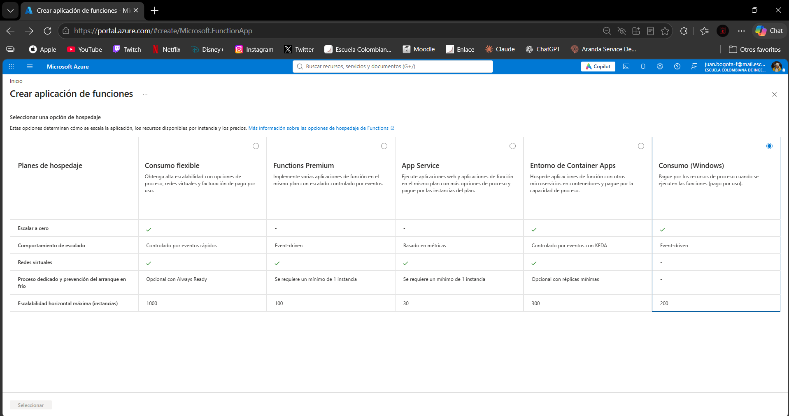

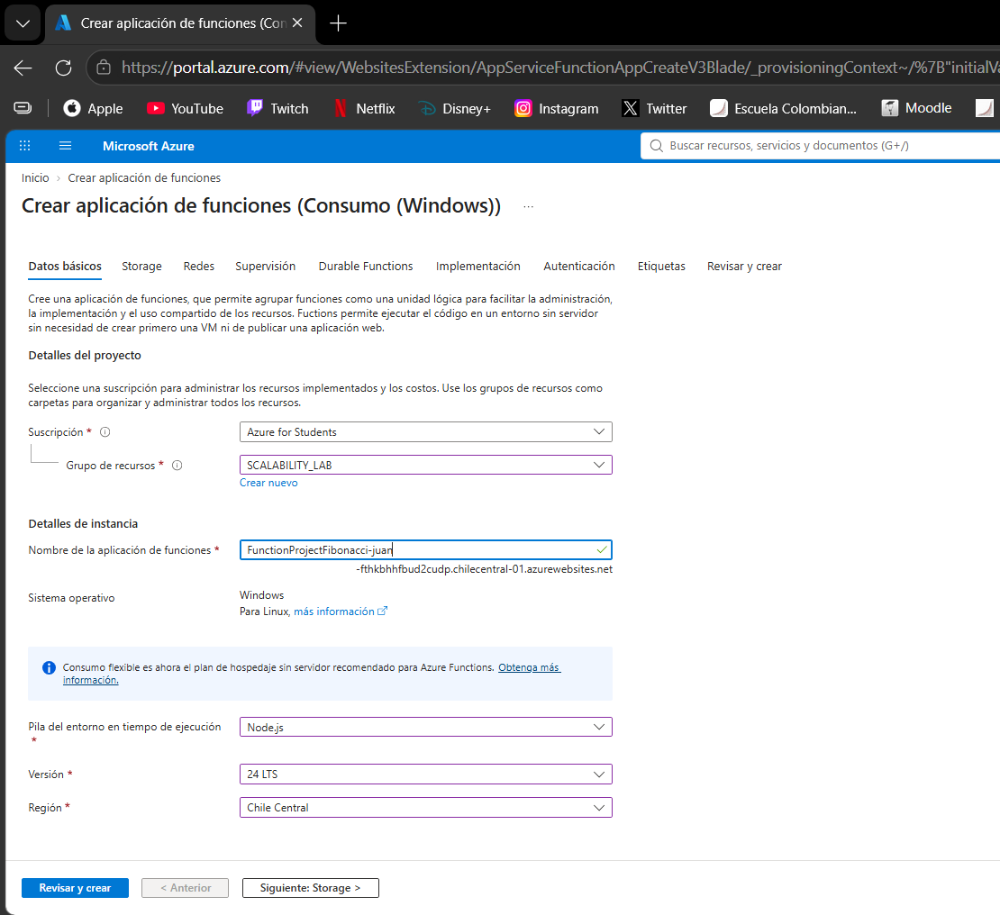

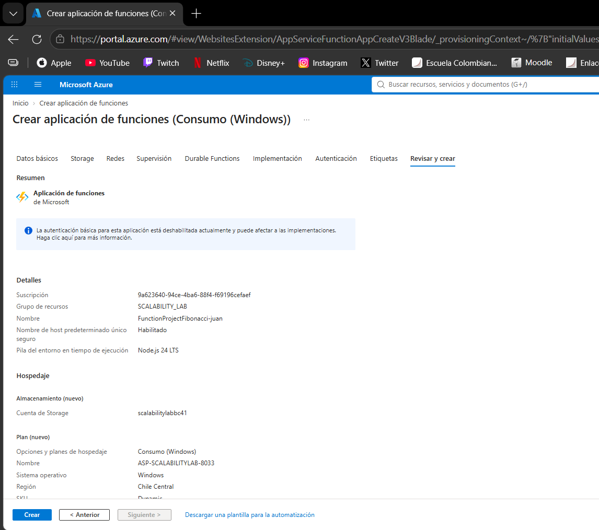

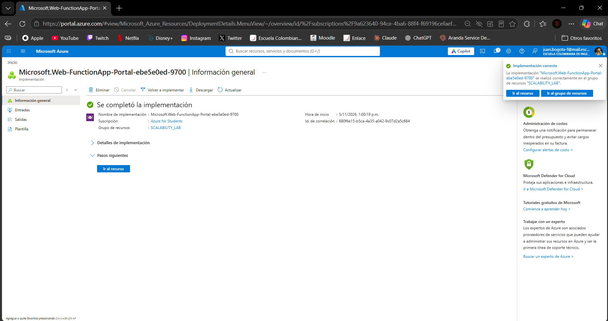

Paso 2, extensión de Azure Functions. Se instaló la extensión Azure Functions de Microsoft en Visual Studio Code, versión 1.22.2.

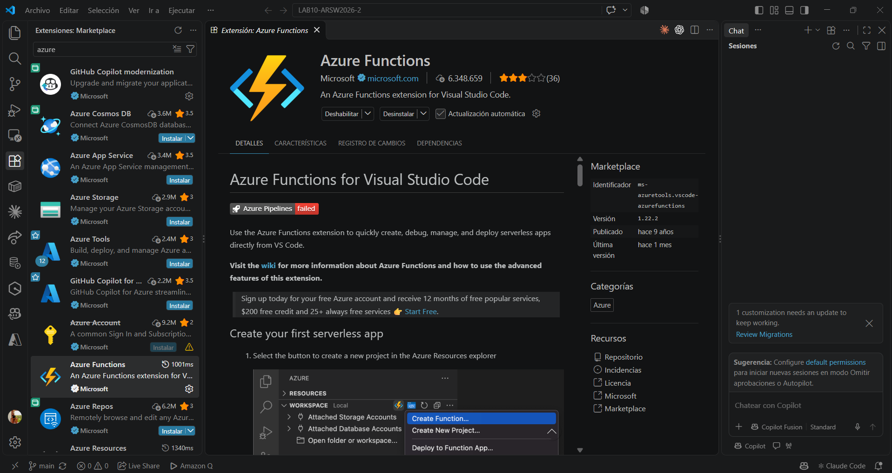

Paso 3, desplegar la función. Se desplegó con la opción Deploy to Function App del panel de Azure. Antes de desplegar, VS Code mostró un aviso que decía que la aplicación usaba una versión obsoleta del extension bundle, `[1.*, 2.0.0)`, y recomendaba subir a `[4.*, 5.0.0)`. Ese aviso resultó ser importante, como se ve en el paso siguiente.

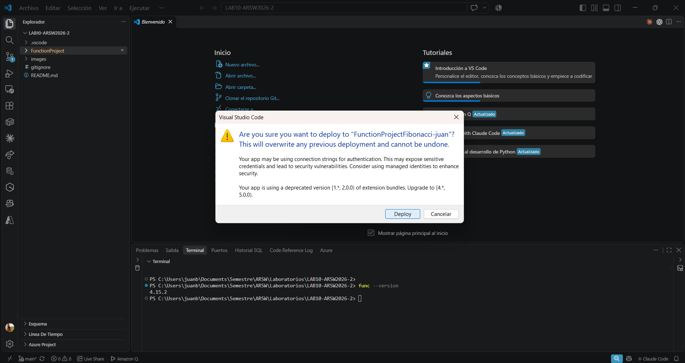

Después del despliegue, en el portal la aplicación aparecía En ejecución y la función Fibonacci aparecía con desencadenador HTTP y estado Habilitada.

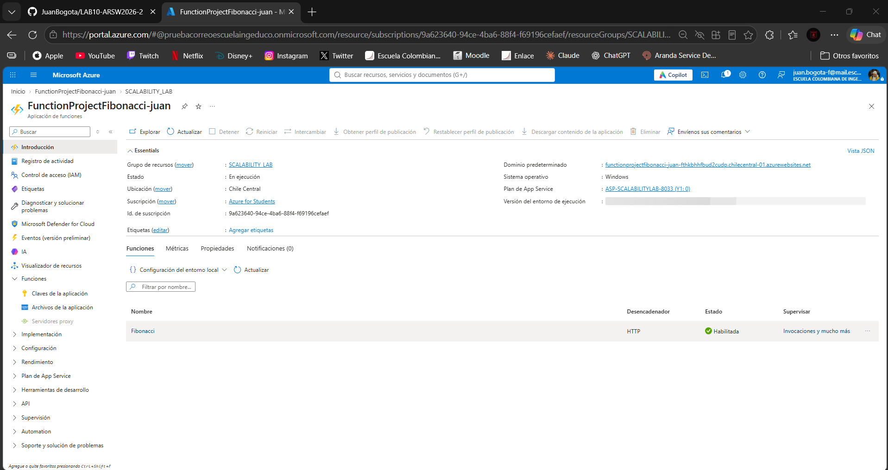

Paso 4, probar la función en el portal. La primera prueba falló. Con el método POST y el cuerpo `{ "nth": 10 }`. Nos tocó hacer unos cambios:

| Archivo | Antes | Después |
|---|---|---|
| `FunctionProject/host.json` | `"version": "[1.*, 2.0.0)"` | `"version": "[4.*, 5.0.0)"` |
| `.vscode/settings.json` | `"azureFunctions.projectRuntime": "~2"` | `"azureFunctions.projectRuntime": "~4"` |

Se volvió a desplegar y esta vez terminó bien en 25 segundos. En la salida se ve que el despliegue comprime y sube la carpeta, construye la aplicación en Azure y corre el `npm install` posterior.

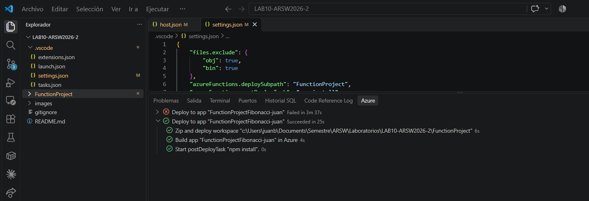

Con el despliegue nuevo, la misma prueba respondió 200 y el resultado fue 55, que es el décimo número de Fibonacci. En el registro del portal aparece que la función se ejecutó en 152 ms.

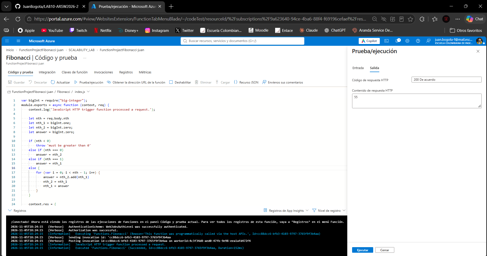

Paso 5, Newman con 10 peticiones concurrentes. En el repositorio no venía la colección de Postman que menciona el enunciado, así que se creó una en la carpeta `load-test`. La colección tiene una sola petición, un POST a `{{baseUrl}}/api/Fibonacci` con el cuerpo `{ "nth": {{nth}} }`, y dos pruebas, que el código sea 200 y que la respuesta no venga vacía.

Newman por sí solo ejecuta las peticiones una detrás de otra, así que no sirve para simular usuarios al mismo tiempo. Por eso se hizo el script `run-concurrent.js` con ayuda de Claude, que lanza varias ejecuciones de Newman a la vez y muestra el código y el tiempo de cada una. Se usa con la cantidad de peticiones y el valor de n.

Se hicieron tres pruebas desde un computador personal contra la función desplegada en Chile Central.

Prueba 1. 10 peticiones concurrentes con n igual a 1000, solo para comprobar que todo estaba conectado. Respondieron las 10 con 200, cada una entre 526 ms y 1329 ms, y todo terminó en 1925 ms. Casi todo ese tiempo es de red y de arranque, porque la aplicación recibía tráfico por primera vez.

Prueba 2, una sola petición. Con n igual a 1000000 respondió 200 en 8479 ms. Esto sirvió para saber cuánto tarda una petición sola y confirmar que queda lejos del límite de unos 230 segundos que tienen las funciones HTTP en Azure.

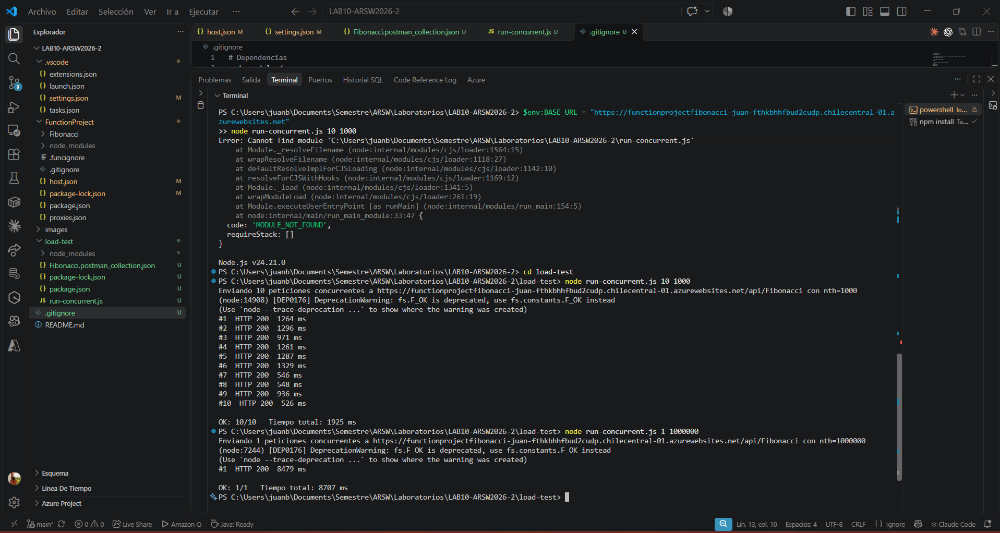

Prueba 3, la del escenario de calidad. 10 peticiones concurrentes con n igual a 1000000. La salida completa quedó guardada en `load-test/resultados-10x1M.txt`.

| Petición | Código | Tiempo |
|---|---|---|
| 1 | 200 | 92.400 ms |
| 2 | 200 | 10.565 ms |
| 3 | 200 | 92.407 ms |
| 4 | 200 | 9.741 ms |
| 5 | 200 | 92.348 ms |
| 6 | 200 | 10.108 ms |
| 7 | 200 | 92.487 ms |
| 8 | 200 | 92.373 ms |
| 9 | 200 | 92.426 ms |
| 10 | 200 | 92.444 ms |

Respondieron las 10 peticiones con 200 y ninguna falló. Todo el lote terminó en 93.025 ms. Los tiempos no salieron parejos, sino en dos grupos.

| Grupo | Peticiones | Tiempo |
|---|---|---|
| Rápidas | 3 (la 2, la 4 y la 6) | de 9,7 s a 10,6 s, media de 10,1 s |
| Lentas | 7 (la 1, la 3, la 5 y de la 7 a la 10) | de 92,3 s a 92,5 s, media de 92,4 s |

El tiempo medio de las 10 fue de 67,7 s.

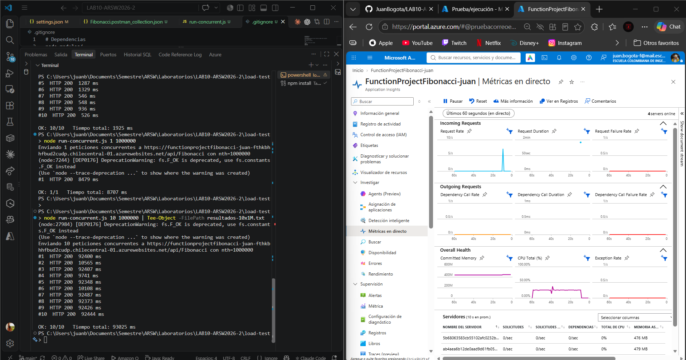

En cuanto a la CPU durante la prueba, mientras corría la prueba se tuvo abierta la pantalla métricas en directo de Application Insights. Marcaba 4 servidores en línea. En el pico, uno solo llegó a cerca de 100 % de CPU (la tabla de servidores mostró 100 % y en otra captura 101 %) y los otros 3 estaban en 0 %.

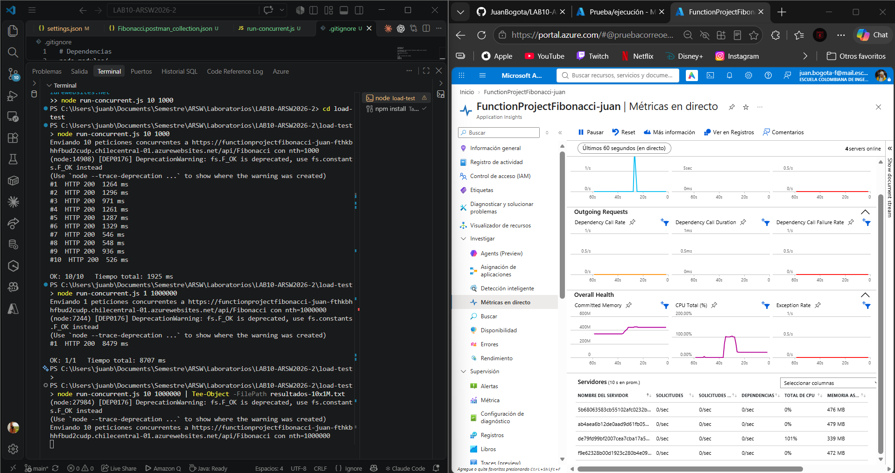

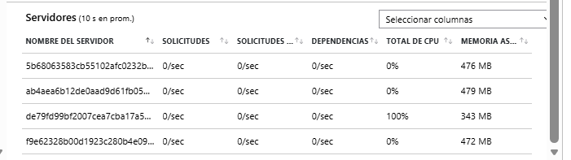

Lo que creemos que pasó es que había 4 instancias y las peticiones no se repartieron por igual. 3 peticiones cayeron cada una en una instancia libre y tardaron más o menos lo que tarda una sola petición, unos 10 s. Las otras 7 cayeron todas en la misma instancia. Esa instancia solo tiene un procesador y Node ejecuta el código en un solo hilo, así que calculó las 7 una detrás de otra con la CPU al tope. Por eso las 7 salieron casi al mismo tiempo, a los 92 s, que son unos 13 s por cálculo en lugar de los 8,5 s de la petición sola. Esto es una explicación y no una comprobación, porque no se midió qué instancia atendió cada petición. Lo que sí está medido es que hubo 4 servidores, que solo uno subió al 100 % de CPU y que los tiempos salieron en dos grupos de 3 y 7.

El escenario pide que todas las peticiones sean respondidas y que la CPU no pase de 70 %. 
Con serverless no se perdió ninguna petición, pero el escenario no se cumple por completo. La plataforma sí creó varias instancias, pero repartió mal la carga. Una instancia se saturó y 7 de las 10 peticiones tardaron más de 90 segundos.

Paso 6, Fibonacci recursivo con memoization. Esta parte se hizo en una segunda Function App, `FunctionProjectFibonacciKaliche`, creada en otra cuenta de Azure (Azure for Students, grupo de recursos `SCALABILITY_LAB_II`, Chile Central, plan Consumo en Windows y runtime 4.x), porque el trabajo del laboratorio se repartió entre los dos integrantes. Por eso la instancia y sus tiempos no son los de las pruebas del paso 5.

Se creó una nueva función, `FibonacciMemo` (carpeta `FunctionProject/FibonacciMemo`). Calcula `fib(n) = fib(n-1) + fib(n-2)` de forma recursiva y guarda cada resultado en un `Map` que vive en la memoria del proceso, así que un valor ya calculado no se vuelve a calcular. Para poder ver qué pasa con la memoria, la respuesta incluye si el valor ya estaba guardado (`cacheHit`), cuántos valores había en la caché antes y después, el identificador de la instancia que respondió (`WEBSITE_INSTANCE_ID`) y cuántos segundos lleva encendida esa instancia. Las pruebas se hicieron con el script `load-test/memo-test.js`, que llama a la función con n igual a 10, 100, 1000, 5000 y 1000000.

El primer despliegue desde Visual Studio Code falló con el mensaje `Offset to Central Directory cannot be held in an Int64`, que quiere decir que el servidor no pudo leer el zip. En el mismo registro aparecían errores de red (`ENOTFOUND cdn.functions.azure.com`). Se volvió a desplegar sin cambiar nada y esta vez terminó bien.

Primera ronda, justo después de desplegar. Con la instancia `879a4f34` recién encendida (unos 200 s de uptime), ningún valor estaba guardado y la caché fue creciendo con cada n.

| n | Código | cacheHit | Caché (antes → después) |
|---|---|---|---|
| 10 | 200 | false | 2 → 11 |
| 100 | 200 | false | 11 → 101 |
| 1000 | 200 | false | 101 → 1001 |
| 5000 | 200 | false | 1001 → 5001 |
| 1000000 | 500 | no aplica | stack overflow |

Con n igual a 1000000 la función respondió 500 con el mensaje de desbordamiento de pila. Con recursión, Node no aguanta una profundidad tan grande, así que este valor falla aunque haya memoization. Es una diferencia importante con la versión iterativa del paso 5, que sí calculó ese valor en unos 8,5 s.

Pruebas repetidas, minutos después de la primera. Se corrió el mismo script tres veces seguidas (7:32:20, 7:32:26 y 7:32:30 p. m.). En todas, los valores 10, 100, 1000 y 5000 salieron con `cacheHit` en true, la caché se quedó en 5001 valores y la instancia siguió siendo `879a4f34`, con el uptime subiendo de 213 a 224 s.

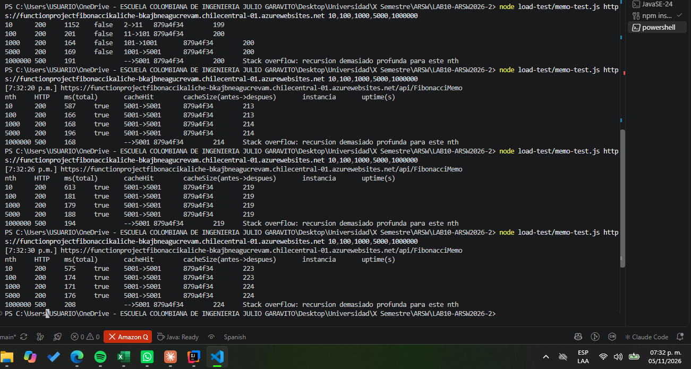

Prueba tras inactividad. Después de la última llamada (7:42:57 p. m.) no se volvió a usar la función. El resultado dependió de cuánto se esperó:

| Cuándo | Tiempo sin tráfico | Instancia | Uptime | cacheHit | Caché (antes → después) |
|---|---|---|---|---|---|
| 7:32:30 p. m. | pocos segundos | `879a4f34` | 224 s | true | 5001 → 5001 |
| 7:41:18 p. m. | unos 9 min | `879a4f34` | 752 s | true | 5001 → 5001 |
| 7:42:57 p. m. | unos 3 s | `879a4f34` | 850 s | true | 5001 → 5001 |
| 8:37:24 p. m. | unos 54 min | `306eac1b` | 0 a 1 s | false | 2 → 11, 11 → 101, 101 → 1001, 1001 → 5001 |

A los 9 minutos sin tráfico la caché seguía intacta y el uptime siguió contando sin reiniciarse (de 224 s a 752 s hay justo los 8 min 48 s que pasaron). A los 54 minutos la respuesta vino de otra instancia, con otro identificador, uptime en cero, y la caché empezó de nuevo con solo 2 valores y volvió a crecer igual que en la primera ronda. La primera petición de esa ronda, n igual a 10, tardó 1442 ms frente a unos 170 ms de las demás.

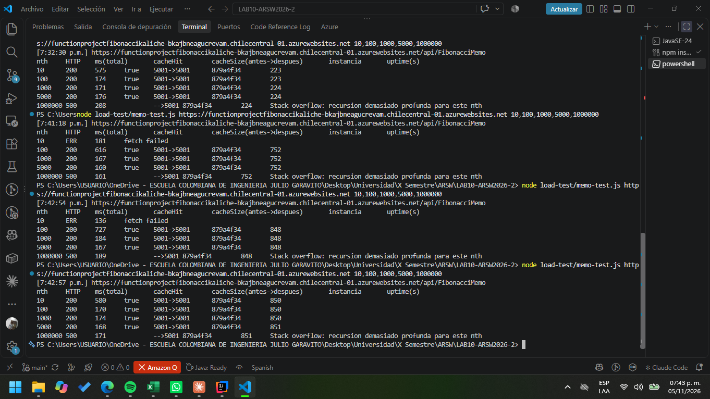

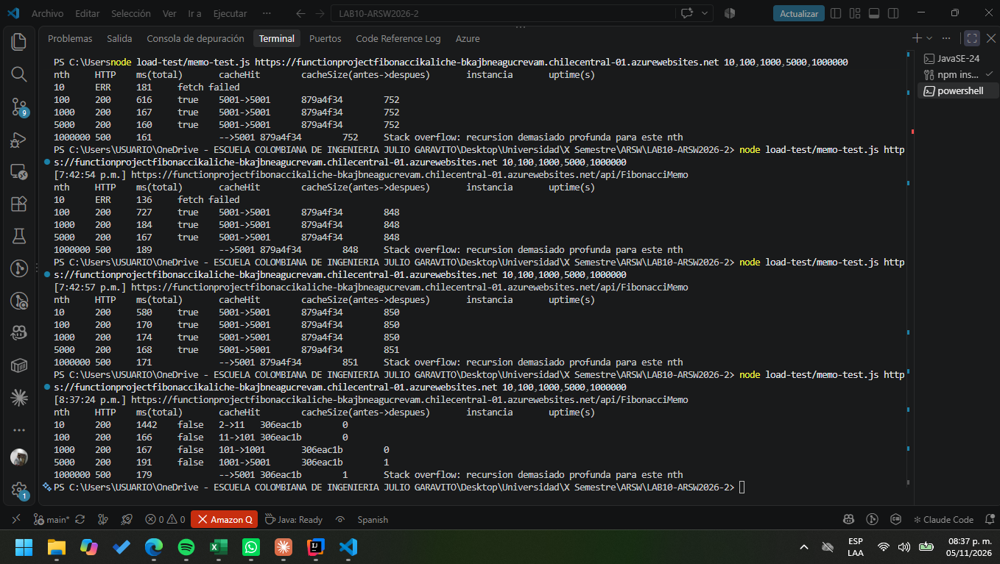

Lo que se midió es que la instancia cambió y que la caché se perdió entre los 9 y los 54 minutos de inactividad. No se midió en qué minuto exacto pasó ni la causa, porque Azure no avisa cuándo apaga una instancia y no se revisaron los registros de Application Insights. Lo más probable es que Azure apagara la instancia por inactividad, algo que el plan Consumo hace, y que la petición siguiente levantara una nueva. En las pruebas con n igual a 10 hubo además dos errores `fetch failed` en la primera llamada de una corrida que llegó después de una pausa. La función respondió bien en las demás llamadas, así que se toman como un fallo de red del equipo desde donde se probó, aunque no se pudo comprobar.

Comportamiento: mientras la instancia sigue encendida, la memoization funciona y los valores ya calculados se responden desde la memoria. Cuando la instancia se apaga o se reemplaza, esa memoria se pierde y todo se calcula otra vez. Con n muy grande la versión recursiva ni siquiera llega a calcularse por el desbordamiento de pila.

#### Respuestas

* ¿Qué es un Azure Function?

Es un servicio de Azure para ejecutar un pedazo de código, la función, cuando pasa un evento. El evento puede ser una petición HTTP, un mensaje en una cola o un temporizador. En el laboratorio la función es Fibonacci y la activa una petición HTTP.

* ¿Qué es serverless?

Es un modelo donde uno no administra los servidores. Los servidores siguen existiendo, pero los maneja Azure. Uno solo sube el código, Azure crea o quita instancias según la demanda y se paga por lo que se usa. Su desventaja es el arranque en frío, que es la demora cuando hay que levantar una instancia nueva. En nuestra prueba con n igual a 1000 las respuestas tardaron entre 0,5 y 1,3 segundos aunque el cálculo era muy pequeño.

* ¿Qué es el runtime y que implica seleccionarlo al momento de crear el Function App?

Es el entorno donde corre la función. Hay dos. El runtime de Functions es el programa de Azure que recibe los eventos y ejecuta las funciones, y hoy se usa la versión 4.x. El runtime del lenguaje es el que se escoge al crear la app, en nuestro caso Node.js 24 LTS. Escogerlo define el lenguaje del código, que no se puede cambiar cuando ya hay funciones creadas, y todo lo demás tiene que ser compatible con esa versión. A nosotros nos pasó con el extension bundle viejo del `host.json`, que dio el error 503 hasta que lo cambiamos a `[4.*, 5.0.0)`.

* ¿Por qué es necesario crear un Storage Account de la mano de un Function App?

Porque Azure Functions la necesita para funcionar. Ahí guarda cosas internas como las claves de las funciones y el estado de los triggers, y en el plan Consumo de Windows también el contenido de la aplicación para poder crear instancias nuevas al escalar. Sin esa cuenta la aplicación deja de funcionar. La nuestra se llama scalabilitylabbc41 y se cobra aparte.

* ¿Cuáles son los tipos de planes para un Function App?, ¿En qué se diferencias?, mencione ventajas y desventajas de cada uno de ellos.

Hay cinco opciones. La tabla sale de la pantalla de planes del portal.

| Plan | Escala a cero | Máximo de instancias | Redes virtuales |
|---|---|---|---|
| Consumo flexible | Sí | 1000 | Sí |
| Functions Premium | No, mínimo 1 instancia | 100 | Sí |
| App Service | No, mínimo 1 instancia | 30 | Sí |
| Entorno de Container Apps | Sí | 300 | Sí |
| Consumo (Windows) | Sí | 200 | No |

Consumo (Windows). Es el que usamos. Ventajas, solo se paga cuando se ejecuta y puede bajar a cero instancias. Desventajas, tiene arranque en frío, no permite redes virtuales y el tiempo máximo de ejecución es de 10 minutos. Microsoft ya lo considera un plan heredado.

Consumo flexible. Es el que el portal recomienda ahora. Ventajas, escala más rápido, permite redes virtuales y se pueden dejar instancias siempre listas para evitar el arranque en frío. Desventajas, solo funciona en Linux y las instancias siempre listas se pagan aunque no haya tráfico.

Functions Premium. Siempre tiene al menos una instancia encendida. Ventajas, casi no tiene arranque en frío y ofrece más CPU y memoria. Desventajas, es más caro porque siempre se paga esa instancia y no baja a cero.

App Service. La función corre dentro de un plan de App Service, como una aplicación web normal. Ventajas, el costo es predecible y sirve para procesos largos. Desventajas, se paga aunque no se use, tiene como mínimo una instancia y escala más lento porque se basa en métricas.

Container Apps. La función va dentro de un contenedor. Ventajas, permite usar librerías propias y escala sin administrar Kubernetes. Desventajas, solo funciona con contenedores Linux y es más complejo de armar.

* ¿Por qué la memoization falla o no funciona de forma correcta?

La memoization guarda en la memoria de la función los resultados que ya se calcularon. En serverless esa memoria no es confiable. Cada instancia tiene su propia memoria y en nuestra prueba había 4 servidores, así que una petición puede caer en una instancia que no tiene nada guardado. Además Azure apaga las instancias cuando pasan un tiempo sin tráfico y la nueva empieza con la memoria vacía, y eso se comprobó en el paso 6: después de unos 9 minutos sin tráfico la caché seguía igual, pero a los 54 minutos la respuesta vino de otra instancia, con el uptime en cero y la caché vacía, así que todo se calculó otra vez. Y con un n de un millón la recursión pasa el límite de llamadas de Node y da error. La solución es guardar los resultados fuera de la función, por ejemplo en una caché externa como Redis, porque una función serverless no debe guardar estado, como dice el principio de ausencia de estado de SOA.

* ¿Cómo funciona el sistema de facturación de las Function App?

Depende del plan. En el plan Consumo se paga por dos cosas. Una es el número de ejecuciones, y el primer millón de cada mes es gratis. La otra es el consumo de recursos, que es la memoria usada por el tiempo que dura cada ejecución, medido en GB por segundo, y cada mes hay 400.000 GB por segundo gratis. En Consumo flexible es parecido, pero con una concesión gratis menor, y si se usan instancias siempre listas también se paga por tenerlas. En Premium no se cobra por ejecución, se paga la CPU y la memoria de las instancias y siempre hay al menos una. En App Service se paga como cualquier plan, por las instancias. La cuenta de almacenamiento se cobra aparte en todos los casos.

Estas respuestas se contrastaron con la documentación de Microsoft sobre las [opciones de hospedaje de Azure Functions](https://learn.microsoft.com/azure/azure-functions/functions-scale), las [consideraciones de almacenamiento](https://learn.microsoft.com/azure/azure-functions/storage-considerations), las [versiones del runtime](https://learn.microsoft.com/azure/azure-functions/functions-versions) y los [precios](https://azure.microsoft.com/en-us/pricing/details/functions/).
